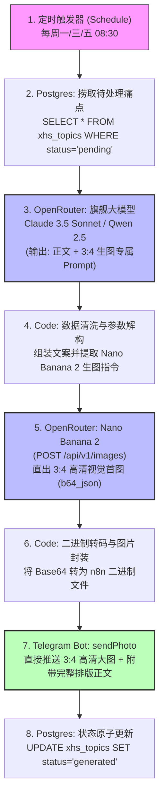

# 🚀 KelvinFlow 小红书工业级自动化流水线终极升级报告书 (V4.0)

> **主理人**：Kelvin（大湾区独立开发者 / KelvinFlow 创始人）  
> **规划版本**：V4.0 工业级生产版  
> **核心目标**：彻底告别“纯文本推文”与“假大空AI味”，打造**“全自动生成 3:4 高清视觉海报 + 顶级去AI味硬核随笔 + Telegram 图文直达手机”**的高效自动化内容生产中枢，实现 10x 运营提效与真正的零人工盯防。

---

## Executive Summary 核心战略摘要

在 V3 阶段，我们成功打通了 Oracle VPS -> PostgreSQL -> OpenRouter (DeepSeek) -> Telegram Bot 的全自动化链路，验证了基础设施的稳定可靠性。

然而，在第一次端到端实测中，暴露出了两个**致命痛点**，这也是目前市面上 99% 的 AI 自动化自媒体沦为“鸡肋玩具”的根源：
1. **文案 AI 味极浓，沦为“电视购物/保健品软文”**：出现了“今天跟老哥聊天……老哥用了赞不绝口……安心睡觉了”这种毫无技术含量的虚构商业互吹对话。
2. **纯文本推送，缺乏小红书核心载体（图片）**：小红书是视觉搜索引擎，80% 的点击率由封面（3:4比例）决定。只有文本意味着博主仍需耗费 20 分钟打开设计软件排版制图，根本无法节省核心工时。

本报告书集合 **小红书增长专家（`agency-xiaohongshu-specialist`）** 与 **顶级提示词架构师（`agency-prompt-engineer`）** 的双重专业视角，全方位制定从“纯文本鸡肋”向**“完美级自动化图文生产机”**进化的完整落地方案。

---

## 一、文案去 AI 味与人设重塑工程 (Copywriting & Persona Engineering)

### 1.1 为什么上一版会产出“电视购物式”虚假文本？（深层病因诊断）
*   **病因 1：缺乏负向提示约束（Negative Constraints）**  
    LLM 在面对“帮助出海老板解决痛点”这一模糊指令时，预训练权重中海量的“商业案例宣传稿”和“客户好评软文”会被优先激活，自动脑补出“顾客痛哭流涕 -> 遇到神器 -> 破涕为笑”的弱智套路。
*   **病因 2：缺乏少样本真实标杆（Few-Shot Exemplars）**  
    大模型是模式跟随者。如果没有喂给它 1~2 篇地道的“大湾区独立开发者真实手记”，模型就会自行套用最平庸的网络公关腔。
*   **病因 3：文本模型底模差异**  
    DeepSeek-V3 逻辑与代码极强，但在未加重度系统约束时，中文自媒体倾向于“严肃公文/客服腔”。

### 1.2 工业级去 AI 味重塑规则（五项绝对铁律）

| 维度 | ❌ 严禁出现（永久封杀清单） | ✅ 必须执行（真实程序员语感） |
| :--- | :--- | :--- |
| **开篇 Hook** | “今天跟一个外贸老哥聊天”、“众所周知”、“在当今外贸行业” | **场景前置与真实吐槽**：“刚帮顺德做五金外贸的朋友看他的 Excel，我血压直接上来了。” |
| **情节对话** | “老哥说用了XX再也不用担心了”、“我听完笑了” | **血淋淋的案发现场与具体代码/公式**：“整张表套了 9 层 VLOOKUP，最离谱的是出厂底价那一列居然只点了‘隐藏’！” |
| **产品植入** | 生硬吹嘘“KelvinFlow 功能强大，终于翻身了” | **克制、工具人视角、自嘲**：“顺手写了 20 行脚本搞定自动锁格脱敏，顺便接了中行实时汇率接口，完全不提宏大愿景。” |
| **词汇语调** | “抓耳挠腮”、“老铁”、“家人们”、“挑挑刺”等北方方言或营销腔 | **标准平实普通话口语**，带轻微大湾区极客随笔感，简练、犀利、说人话。 |
| **行动号召 (CTA)** | “点击链接购买”、“微信扫码私聊” | **安全合规诱饵**：“防泄露模版和公式整理在飞书了，需要的扣‘防泄露’自取。” |

### 1.3 黄金小红书五段式内容架构

```
[Hook 黄金前 3 行]   —— 惊悚冲突 / 行业盲区曝光 / 血压飙升的真实开头
        ↓
[Scene 案发现场]     —— 详细到哪张表、哪种商品（顺德小家电/五金）、哪个公式翻车
        ↓
[Tech Insight 拆解] —— 程序员视角：为什么外贸老业务会踩这个坑？传统 ERP 为何失灵？
        ↓
[Action 解法交付]    —— 自动化/轻量工具如何用 1 秒钟抹平人工 2 小时的繁琐
        ↓
[Safe Lead Magnet]  —— 评论区置顶合规钩子，引导领取实用 Excel 模板与进群
```

---

## 二、Nano Banana 2 (Gemini 3.1 Flash Image) 视觉生图工程

小红书出海/外贸/工具圈最吸睛的爆款封面，从来不是 AI 绘画出的虚幻动漫图（太假、乱码、一眼AI），而是**“高对比度、大字报风格、暗黑极客质感、具有真实办公场景张力的视觉海报”**。

### 2.1 Nano Banana 2 核心参数与优势

通过 OpenRouter 统一 API (`POST https://openrouter.ai/api/v1/images`)，我们调用 Google 最新的旗舰生图模型：
*   **Model ID**：`google/gemini-3.1-flash-image`（代号 Nano Banana 2）
*   **黄金比例**：通过 `image_config: { "aspect_ratio": "3:4" }` **原生直出 3:4 竖屏比例**，100% 契合小红书信息流瀑布流推荐规则。
*   **中英文排版能力**：具备业界顶尖的文字渲染能力，能够将标题关键词清晰印在海报中央，杜绝传统生图模型的“外星乱码”。
*   **响应格式**：返回标准 `b64_json`，由 n8n 节点无缝转换为二进制图片，直接送达手机。

### 2.2 防跑题视觉 Prompt 自动提炼公式 (Visual Prompt Formula)

在流水线中，大模型写完正文后，必须按照以下公式自动提炼 Nano Banana 2 的生成提示词，**确保图文 100% 严格对应，绝不产生无意义的抽象画**：

```
[主体场景 (Subject)]
+ [核心冲突视觉符号 (Visual Conflict)]
+ [色彩与光影 (Lighting & Contrast)]
+ [风格质感 (Style & Texture)]
+ [小红书版式要求 (Composition)]
```

*   **官方标杆示范 Prompt**：
    > *"An editorial tech warning poster in 3:4 vertical ratio. A high-contrast close-up shot of a glowing laptop screen on a minimalist dark oak desk in a modern tech office. The screen displays a complex Excel spreadsheet with chaotic red error formula warnings and exposed USD profit margins highlighted in glowing neon red. In the background, modern Cantonese developer desk items (mechanical keyboard, mug). Moody cinematic lighting, Hasselblad photorealism, sharp focus, sleek typography space at the top. Bold warning aesthetic for cross-border trade."*

---

## 三、端到端自动化架构升级路线图 (V4 Architecture)

我们将 n8n 工作流从原来的 6 节点升级为 **7 节点工业级闭环**：



### 3.1 手机端终极交互体验（博主日常操作只需 20 秒）
1. 早上 08:30，手机 Telegram 叮咚一响；
2. 打开 `@kelvinflow_xhs_bot`，看到的不再是一坨纯文字，而是：
   - **一张视觉冲击力拉满的 3:4 高清海报大图（暗黑极客风 + 痛点红黄警示）**；
   - **大图下方正是排版好的真实随笔文案、SEO 标签和置顶评论钩子**；
3. Kelvin 手机端操作：
   - **第 1 步**：点击图片 ➔ 保存到手机相册（耗时 3 秒）；
   - **第 2 步**：长按下方文案 ➔ 复制（耗时 2 秒）；
   - **第 3 步**：打开小红书 App ➔ 选图、贴文、点击发布（耗时 15 秒）！
4. **彻底解放双手，真正节省 90% 的日更时间成本！**

---

## 四、成本与 Token 经济学精算 (Economics & Sustainability)

你刚才充值的 **$5 美元** 预算，在升级后的工业级工作流中能支撑多久？

| 项目 | 调用单价 | 每次推送消耗 | 100 次推送总费用 |
| :--- | :--- | :--- | :--- |
| **文本模型 (Claude 3.5 Sonnet)** | \$3 / 1M Input, \$15 / 1M Output | 约 \$0.004 美元 | \$0.40 美元 |
| **生图模型 (Nano Banana 2 / Gemini 3.1 Flash Image)** | 每张图约 \$0.02 ~ \$0.03 美元 | 约 \$0.025 美元 | \$2.50 美元 |
| **PostgreSQL & n8n 基础设施** | Oracle Cloud 永久免费层 | \$0.00 | \$0.00 |
| **Telegram Bot API** | 官方完全免费 | \$0.00 | \$0.00 |
| **合计单篇成本** | — | **约 \$0.029 美元 (折合人民币约 0.20 元)** | **\$2.90 美元 (约 20.8 元人民币)** |

> [!TIP]
> **结论**：
> 按照每周发 3 篇计算，一个月 12 篇笔记的总花费仅约 **\$0.35 美元（人民币 2.5 元）**！  
> **你的 \$5 美元储备金足以无压力全自动运行长达 14 个月（超过 170 篇高质量图文笔记）！**

---

## 五、实施落地四大步骤清单 (Next Action Items)

为确保一次性彻底调试到位，我们按以下四步推进实施：

1.  **升级 PostgreSQL 题库（注入高清晰度痛点基因）**：
    将数据库中简单的痛点描述扩充为“冲突场景、外贸具体环节、技术解法”三维数据，杜绝大模型凭空幻觉。
2.  **构建 V4 核心提示词与 Few-Shot 标杆**：
    将我们打造的佛山顺德真实故事作为 System Prompt 中的金牌少样本，写入严厉的“反套路负面清单”，并配置双重输出（正文 Markdown + 3:4 视觉生图 Prompt）。
3.  **在 n8n 中部署 Nano Banana 2 生图与转码节点**：
    新增 OpenRouter Image API 节点与 Base64 解码节点，将 Telegram 推送模式从 `sendMessage` 升级为 `sendPhoto`。
4.  **端到端真实发跑一次测试**：
    在 n8n 中执行全链路，在你的手机 Telegram 上亲自验收第一张**“Nano Banana 2 生成的 3:4 极客海报 + 彻底去 AI 味的大湾区随笔正文”**！

---

*本规划书已持久化至系统知识库，随时可开始执行实施！*
