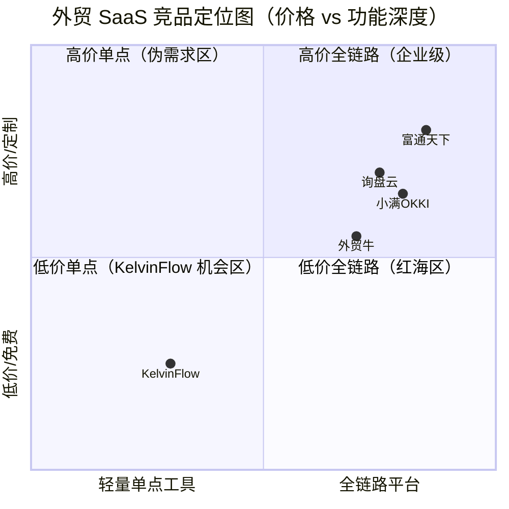
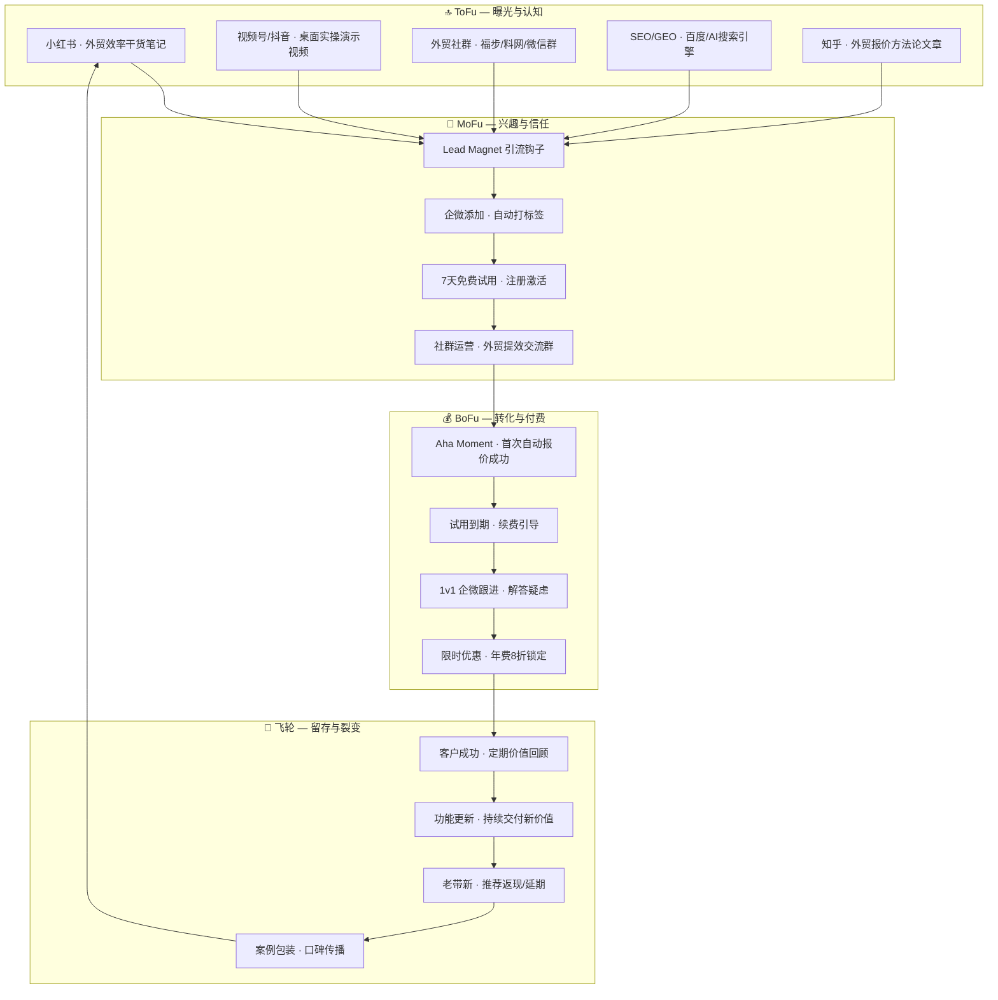
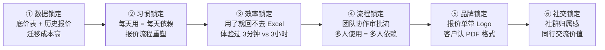

# KelvinFlow AI 外贸报价引擎 — 国内市场 GTM 全案

> **版本**：v1.0 | **日期**：2026-09-15  
> **产品**：KelvinFlow Trade Core — AI 外贸自动核价出单系统  
> **官网**：https://quote.kelvinflow.com  
> **目标市场**：中国中小外贸制造企业 & 贸易公司

---

## 一、市场格局与竞争分析

### 1.1 2026 年中国外贸 SaaS 市场概览

| 维度 | 数据 |
|------|------|
| 外贸主体 | 民营企业进出口占比稳居 **60%+**，中小企业是绝对主力 |
| SaaS 渗透率 | 跨境电商 ERP 渗透率约 **49.6%**，但 AI 报价类工具渗透率 **< 5%** |
| 核心痛点 | "增收不增利"、人工报价慢/易错、缺乏数字化能力、多市场差异化应对难 |
| 行业趋势 | 从"工具信息化"→"AI Agent 驱动的业务全链路闭环"；混合计费模式成主流 |

### 1.2 竞品矩阵分析



| 竞品 | 定位 | 年费参考 | 核心优势 | 核心短板 |
|------|------|---------|---------|---------|
| **小满 OKKI** | 全链路 CRM + 获客 | 2,000–5,000 元/账号/年 | 阿里生态数据、AI 潜客推荐 | 重 CRM，报价非核心能力 |
| **询盘云** | 营销型 CRM | 系统授权费 + 营销服务费（万元级起步） | SEO/SEM 获客 + 客户旅程管理 | 价格不透明、绑定营销服务 |
| **富通天下** | 独立站 + CRM + ERP | 授权制/年费制（定制报价） | 私域流量、全链路集成 | 学习曲线高、中大型企业导向 |
| **外贸牛** | 全网营销获客 | 定制报价 | 多渠道线索整合 | 报价功能弱 |

> [!IMPORTANT]
> **KelvinFlow 的差异化定位**：上述竞品全部聚焦于 CRM/获客/营销管理，**没有一家**专注于"询盘→报价"这一高频高痛点环节的 AI 自动化。KelvinFlow 不是在红海中竞争，而是**开辟了一个全新的垂直品类**：AI 智能报价引擎。

### 1.3 KelvinFlow 竞争优势 SWOT

| | 有利 | 不利 |
|---|------|------|
| **内部** | **S 优势**：①唯一专注 AI 报价的垂直工具 ②轻量即开即用 ③AI 多模型级联保障稳定性 ④成本极低（Gemini API + 单 VPS） | **W 劣势**：①品牌认知度零 ②团队规模小（1人） ③无客户案例背书 ④功能深度有限（无CRM/ERP集成） |
| **外部** | **O 机会**：①AI报价品类蓝海 ②中小企业数字化转型刚需 ③竞品报价功能弱 ④低成本短视频获客红利期 | **T 威胁**：①大厂快速跟进 ②中小企业付费意愿偏低 ③API 成本波动 ④地缘政策影响外贸行业景气度 |

---

## 二、价值主张与客户分层定位（ToB vs ToC/员工）

### 2.1 目标客户选择：自下而上（Bottom-up PLG）策略
针对“是面向中小外贸公司老板，还是面向广大外贸业务员”的战略选择，2026年外贸SaaS的最佳路径是：**“ToC的体验获客，ToB的转化买单”（PLG 产品驱动增长模式）**。

| 维度 | 外贸业务员（使用者 User） | 外贸公司老板/经理（购买者 Buyer） |
|------|-------------------------|--------------------------------|
| **核心痛点** | 经常无偿加班拉Excel，怕算错价被扣提成，跨时区回复累 | 业务员流失导致客户/报价数据流失，乱报低价损失利润，报价慢导致丢单 |
| **营销触达** | 小红书“拒绝加班”、抖音实操演示、痛点共鸣 | 行业社群、私域1v1、ROI计算器、安全承诺 |
| **产品价值** | 极致的效率提升（3分钟出单），操作傻瓜化 | 统一底价库管理，审批流风控，沉淀客户资产 |
| **战略定位** | **【切入点】** 用免费试用和“入门版”极速占领他们的办公桌 | **【变现点】** 当公司内有2-3个业务员使用后，向老板推销“专业/企业版” |

> [!TIP]
> **破局打法**：营销内容主要面向**业务员**（教他们如何用 KelvinFlow 准点下班），让他们产生依赖。一旦业务员习惯了 AI 报价，老板为了团队效率和数据统一，自然会愿意统一采购**专业版/企业版**。

### 2.2 Grand Slam Offer — 价值方程式

```
                梦想结果  ×  感知可信度
价值 = ──────────────────────────────────
               时间延迟  ×  努力/牺牲
```

| 维度 | KelvinFlow 的设计 |
|------|------------------|
| **梦想结果** | 业务员：告别通宵拉表；老板：赢单率提升30%，报价0差错 |
| **感知可信度** | 7天免费试用 + 真实桌面实操视频 + "无效全额退" 保障 → 零风险尝试 |
| **时间延迟** | 注册→上传底价表→收到第一份自动报价 < 10分钟 |
| **努力/牺牲** | 零安装、零培训、零 IT 支持 — 浏览器打开即用，上传 Excel 即启动 |

### 2.3 一句话价值主张

> **业务员版**：把复杂算价交给AI，每天准点下班。  
> **老板版**：客户询盘一到，AI 3分钟自动出报价单 — 外贸报价从"通宵拉表"变成"喝茶审批"。

---

## 三、定价策略

### 3.1 成本结构分析

| 成本项 | 月均估算 | 说明 |
|--------|---------|------|
| VPS 服务器（Hostwinds Dallas） | ≈ ¥200/月 | 单台 VPS，可承载约 50 个并发租户 |
| Gemini API 调用 | ≈ ¥0.05–0.15/次 | 3.8-flash 促销价 \$0.75/1M input + \$3.75/1M output；单次询盘约 2K tokens |
| 域名 + SSL | ≈ ¥50/月 | 分摊成本 |
| 人力（创始人） | 不计入边际成本 | 产品研发 + 客服 + 运营 |
| **单租户边际成本** | **≈ ¥5–15/月** | 极低的边际成本是定价空间的核心优势 |

> [!TIP]
> 边际成本极低意味着：即便定价 ¥99/月，毛利率仍可达 **85%+**。这为激进的免费试用和低价获客策略提供了底气。

### 3.2 价值锚定 — 客户经济价值计算

```
传统人工报价成本：
  业务员月薪 ¥8,000 × 报价占工时比 30% = ¥2,400/月 用于报价
  每月处理 50 条询盘 → 每条询盘报价成本 = ¥48

KelvinFlow 自动报价成本：
  月费 ¥199 ÷ 50 条询盘 = ¥3.98/条

客户每月节省：¥2,400 - ¥199 = ¥2,201
ROI = 2,201 / 199 = 11.1x
```

### 3.3 推荐定价方案 — 三级阶梯

| | 🌱 入门版 | ⚡ 专业版（主推） | 🏢 企业版 |
|---|----------|-----------------|----------|
| **月费** | ¥99/月 | ¥199/月 | ¥499/月 |
| **年费（8折）** | ¥948/年（省 ¥240） | ¥1,908/年（省 ¥480） | ¥4,788/年（省 ¥1,200） |
| 每月询盘处理量 | 30 条 | 100 条 | 无限制 |
| AI 模型 | Gemini 3.5 Flash | Gemini 3.8 Flash（最新） | Gemini 3.8 Flash + Pro |
| 底价表上传 | 1 张（单品类） | 5 张（多品类） | 无限制 |
| PDF 报价单生成 | ✅ | ✅ + 自定义 Logo/模板 | ✅ + 完全品牌化 |
| 微信实时推送 | ❌ | ✅ | ✅ |
| 在线审核台 | ✅ 基础版 | ✅ 完整版（含批量调价） | ✅ + 多人审批流 |
| 子账号 | 1 个 | 3 个 | 10 个 |
| 专属客服 | 社群支持 | 1v1 企微客服 | 专属技术顾问 |
| **目标客户** | 个人 SOHO / 试水用户 | **5–20人外贸团队**（主力） | 20人+ 中型外贸企业 |

> [!IMPORTANT]
> **定价策略核心逻辑**：
> 1. **锚定效应**：企业版 ¥499 的存在让专业版 ¥199 显得超值（Decoy Pricing）
> 2. **价值捕获比**：专业版 ¥199/月 ≈ 客户节省 ¥2,200/月的 **9%**，远低于 B2B SaaS 通常的 10–25% 价值捕获比 → 客户感知极高性价比
> 3. **对标竞品**：小满OKKI 2,000–5,000元/账号/年 vs KelvinFlow 专业版 1,908元/年 → **价格持平但功能精准命中报价痛点**
> 4. **年费锁定**：8折年费优惠鼓励年付，提高 LTV 并降低流失

### 3.4 定价敏感性分析（专业版 ±20%）

| 价格点 | 月费 | 年费 | 预估转化率 | 月收入（100用户基数） | 评估 |
|--------|------|------|-----------|---------------------|------|
| -20% | ¥159 | ¥1,526 | ~12% | ¥15,900 | 牺牲利润换规模 |
| **基准** | **¥199** | **¥1,908** | **~10%** | **¥19,900** | ✅ 最优平衡点 |
| +10% | ¥219 | ¥2,102 | ~8% | ¥17,520 | 略高，需更强价值证明 |
| +20% | ¥239 | ¥2,294 | ~6% | ¥14,340 | 需企业级功能支撑 |

---

## 四、营销漏斗设计

### 4.1 全链路漏斗架构



### 4.2 各阶段关键指标

| 漏斗阶段 | 核心指标 | 目标值 | 说明 |
|----------|---------|--------|------|
| **曝光** | 月内容曝光量 | 50,000+ | 小红书 + 视频号 + 社群组合 |
| **引流** | 月新增企微好友 | 200+ | 通过 Lead Magnet 引流 |
| **试用** | 月新注册试用 | 80+ | 企微引导 → 注册激活 |
| **激活** | 试用者完成首次报价率 | ≥ 60% | "10分钟 Aha Moment" 引导 |
| **转化** | 试用→付费转化率 | ≥ 10% | 中国 B2B SaaS 均值 <5%，目标翻倍 |
| **留存** | 月度续费率 | ≥ 85% | 靠产品价值 + 客户成功驱动 |
| **推荐** | 老客推荐率 | ≥ 15% | "老带新送1个月"裂变机制 |

---

## 五、获客渠道策略

### 5.1 渠道优先级排序

> **原则**：先验证 offer → 暖流量 → 免费内容 → 冷触达 → 付费投放。一次聚焦一个渠道，打穿再扩。

| 优先级 | 渠道 | 类型 | 投入 | 预期 ROI | 阶段 |
|--------|------|------|------|---------|------|
| **P0** | 微信外贸群 + 朋友圈 | 暖触达 | 免费 | ★★★★★ | 0–30天 |
| **P1** | 小红书 | 免费内容 | 低成本 | ★★★★☆ | 0–60天 |
| **P2** | 微信视频号 | 免费内容 | 低成本 | ★★★★☆ | 15–90天 |
| **P3** | 外贸论坛（福步/料网） | 暖触达 | 免费 | ★★★☆☆ | 0–30天 |
| **P4** | 知乎 | 免费内容 | 低成本 | ★★★☆☆ | 30–90天 |
| **P5** | 抖音 | 免费内容 | 中成本 | ★★★☆☆ | 60–120天 |
| **P6** | 百度 SEO/GEO | 长期资产 | 低成本 | ★★★☆☆ | 持续 |
| **P7** | DOU+ / 信息流广告 | 付费投放 | 高成本 | ★★☆☆☆ | 验证后 |

### 5.2 P0 — 微信外贸群暖触达（Day 0–30）

**目标**：获得首批 30 个种子用户，验证产品-市场匹配

**战术**：
1. **定位 10–20 个高质量外贸微信群**（佛山/广州/深圳/义乌产业带群）
2. **价值输出先行**：每周在群内分享 2–3 条外贸报价/核价干货（非广告），建立专业人设
3. **Pain Amplifier 话术**：
   > "最近帮一个做灯饰的兄弟算了一下，他团队 3 个人每个月花在 Excel 拉报价表上的时间加起来超过 120 个小时。我在想，这种重复劳动，有没有可能用 AI 来搞掂？于是我做了个小工具，测试了一下效果还不错……"
4. **引流钩子**：私信回复【效率工具】→ 发送企微名片 → 7天免费试用

### 5.3 P1 — 小红书内容矩阵（Day 0–60）

**账号定位**：`KelvinFlow｜自动化实验室`（已有策略文档）

**内容矩阵（70/20/10 法则）**：

| 比例 | 内容类型 | 示例选题 |
|------|---------|---------|
| **70%** 干货价值 | 外贸效率提升技巧 | "外贸报价5个常见坑，第3个最致命" / "Excel 底价表这样整理，效率翻3倍" |
| **20%** 趋势参与 | 外贸行业热点 | "AI 替代外贸业务员？错！是替代你最烦的那部分工作" / "2026外贸人必备的3个效率工具" |
| **10%** 产品展示 | KelvinFlow 实操 | "3分钟从邮件到报价单 — AI 实操全过程" / "看完这个，我再也不想手动拉报价表了" |

**发布节奏**：每周 3–5 篇，晚 7–9 点发布，发布后 2 小时内互动评论区

### 5.4 P2 — 视频号/抖音短视频（Day 15–90）

**内容策略**：100% 不露脸桌面实操流（已有策略文档和粤语脚本）

**爆款视频结构**：

| 时间段 | 作用 | 示例 |
|--------|------|------|
| 0–3秒 | 黄金钩子 | "做外贸的你，还在通宵拉 Excel 报价表？" |
| 4–20秒 | 痛点放大 + 解决方案 | 展示传统报价的痛苦 → 切换到 KelvinFlow 界面 |
| 21–35秒 | 产品实操演示 | 邮件到达 → AI 解析 → 自动出价 → PDF 生成 |
| 36–45秒 | CTA 引导 | "7天免费试用，私信【效率工具】获取链接" |

**矩阵运营**：主号粤语版（佛山/广州受众） + 副号普通话版（全国受众）

### 5.5 私域运营 — 企业微信闭环

**企微 SCRM 架构**：

```yaml
# KelvinFlow 企微私域配置
wecom_config:
  渠道活码:
    - 小红书引流码:
        欢迎语: "Hi~ 感谢关注！我是 KelvinFlow 的 Kelvin。回复 1 领取【外贸报价效率自查清单】，回复 2 直接开通 7天免费试用 👇"
        自动标签: ["小红书", "新用户"]
    - 视频号引流码:
        欢迎语: "感谢从视频号过来！回复【试用】马上开通 7天免费体验～"
        自动标签: ["视频号", "新用户"]
    - 外贸群引流码:
        欢迎语: "兄弟好！听说你对 AI 报价感兴趣？我先发你一份【外贸核价避坑指南】，有问题随时问我 💪"
        自动标签: ["微信群", "暖流量"]

  用户生命周期:
    Day0: 欢迎语 + Lead Magnet 交付
    Day1: 引导注册试用 + 上传底价表教程
    Day3: 检查是否完成首次报价 → 未完成则主动帮助
    Day5: 分享客户案例/使用技巧
    Day7: 试用到期提醒 + 续费优惠（首月 ¥99 → ¥79 限时价）
    Day14: 未付费用户 → 二次触达 + 痛点复访
    Day30: 付费用户 → 满意度回访 + 老带新邀请
```

---

## 六、Lead Magnet 引流钩子设计

### 6.1 三类引流物料

| 类型 | 名称 | 形式 | 目的 |
|------|------|------|------|
| **解决问题型** | 《外贸报价效率自查清单》 | PDF / 小程序 | 帮用户自诊报价流程低效的 7 个信号 → 引出 KelvinFlow 解决方案 |
| **教育型** | 《AI 时代外贸核价方法论白皮书》 | PDF 12页 | 重塑认知：手动报价的隐性成本远超你想象 → 建立权威 → 引流试用 |
| **体验型** | 7天免费试用 | 产品本身 | 让用户亲手感受"邮件到报价单 3分钟"的 Aha Moment |

### 6.2 核心 Lead Magnet — 外贸报价效率自查清单

**设计要点**：
1. 7 个自查项（勾选式），让用户自我诊断
2. 每项附带"行业基准"对比数据
3. 最后给出效率评分 + "如果你命中 4 项以上，建议试试 AI 自动报价"
4. 底部 CTA：扫码开通 7天免费试用

**分发方式**：
- 小红书笔记评论区置顶 + 私信自动回复
- 视频号评论区引导
- 企微好友自动发送
- 外贸群分享（非广告性质的干货分享）

---

## 七、客户转化与留存策略

### 7.1 试用期转化设计 — "10分钟 Aha Moment"

> [!IMPORTANT]
> **核心原则**：用户在注册后 **10分钟内**体验到核心价值（完成首次自动报价），转化率提升 3–5 倍。

**Onboarding 引导流程**：

```
注册成功
  ↓
Step 1: 上传底价表（提供示例模板，30秒完成）
  ↓
Step 2: 转发一封真实询盘邮件到系统邮箱（或粘贴邮件内容）
  ↓
Step 3: 等待 AI 解析（< 30秒）→ 查看自动生成的报价明细
  ↓
Step 4: 进入审核台微调 → 一键生成 PDF 报价单
  ↓
🎉 Aha Moment："这也太快了！"
  ↓
微信推送："您的首份 AI 报价单已生成，点击查看 →"
```

### 7.2 试用到期转化策略

| 时间点 | 动作 | 渠道 |
|--------|------|------|
| Day 5 | "您已成功生成 X 份报价单，节省约 X 小时" — 价值回顾 | 企微 + 系统内通知 |
| Day 6 | "明天试用到期，现在续费享首月 ¥79 专属价" — 限时优惠 | 企微 1v1 |
| Day 7 | "试用已到期，您的 X 份报价数据将保留 7天" — 紧迫感 | 邮件 + 企微 |
| Day 10 | "老板，之前用着感觉怎么样？有什么建议可以聊聊" — 温情跟进 | 企微 1v1 |
| Day 14 | 最终提醒 + "推荐一位同行试用，双方各送1个月" — 裂变 | 企微 |

### 7.3 长期留存 — 黏性设计 "六层锁定"



**具体黏性措施**：

| 层级 | 措施 | 实现方式 |
|------|------|---------|
| **数据锁定** | 底价表 + 历史报价单 + 客户询盘记录沉淀在系统中 | 用越久数据越多，迁移成本越高 |
| **习惯锁定** | 自动报价变成每日工作流的一部分 | 邮件转发→自动出价→微信提醒的肌肉记忆 |
| **效率锁定** | 体验过 3分钟出价后无法回到 Excel | "由奢入俭难"效应 |
| **流程锁定** | 子账号 + 多人审批流 | 团队使用后切换成本指数级增加 |
| **品牌锁定** | 报价单模板含客户 Logo，格式被客户/买家认可 | 改工具 = 改报价单格式 = 客户可能不认 |
| **社交锁定** | VIP 客户社群，同行交流外贸提效经验 | 社群价值 > 工具本身 |

### 7.4 客户成功体系

| 阶段 | 时间 | CSM 动作 |
|------|------|---------|
| **激活期** | Day 0–7 | 引导完成首次报价、解答使用问题 |
| **成长期** | Day 7–30 | 分享高级用法（多品类报价、自定义模板）、收集反馈 |
| **成熟期** | Day 30–90 | 月度价值回顾报告（本月节省 X 小时）、引导升级套餐 |
| **扩展期** | Day 90+ | 老带新激励、案例包装授权、邀请参与产品共建 |

---

## 八、增长飞轮 — 裂变与口碑

### 8.1 推荐裂变机制

```
老用户推荐新用户注册试用
         ↓
新用户完成付费
         ↓
双方各获得 1 个月免费使用
         ↓
推荐 3 个付费用户 → 升级为 VIP（终身 8 折）
```

### 8.2 案例工厂 — 口碑素材批量生产

| 步骤 | 动作 |
|------|------|
| 1 | 识别高活跃付费用户（月报价 > 50 单） |
| 2 | 邀请 15分钟访谈："用 KelvinFlow 前后对比" |
| 3 | 产出三种素材：①小红书图文案例 ②30秒短视频证言 ③官网 Testimonial |
| 4 | 客户授权后在各渠道分发 |
| 5 | 给参与客户赠送 2 个月免费使用 |

### 8.3 KOL/KOC 合作策略

| 层级 | 对象 | 合作方式 | 预算 |
|------|------|---------|------|
| **KOC** | 外贸行业微信群群主 | 免费试用 + 推荐返佣（20%） | 零成本 |
| **小 KOL** | 小红书/视频号外贸博主（1K–10K 粉） | 产品置换 + 定制内容 | ¥500–2,000/篇 |
| **中 KOL** | 外贸行业垂直大V（10K–100K 粉） | 联合直播/深度评测 | ¥3,000–8,000/次 |

---

## 九、30/60/90 天执行路线图

### Phase 1：种子验证（Day 0–30）

| 周 | 核心动作 | 目标 |
|---|---------|------|
| W1 | ① 开通企微 + 配置渠道活码<br/>② 制作 Lead Magnet（效率自查清单）<br/>③ 在 5 个外贸群开始价值输出 | 企微好友 +30 |
| W2 | ① 小红书开号 + 发布首批 5 篇干货<br/>② 外贸论坛（福步/料网）发帖<br/>③ 暖流量 1v1 引导试用 | 试用注册 +15 |
| W3 | ① 视频号发布首条实操视频<br/>② 小红书保持 3篇/周节奏<br/>③ 收集试用用户反馈 | 试用注册 +20 |
| W4 | ① 分析首批用户数据（激活率/使用频率）<br/>② 优化 Onboarding 流程<br/>③ 首批试用到期 → 转化跟进 | 付费转化 ≥3人 |

**Phase 1 里程碑**：验证产品-市场匹配，首批 3+ 付费用户

### Phase 2：内容引擎（Day 31–60）

| 周 | 核心动作 | 目标 |
|---|---------|------|
| W5–6 | ① 小红书矩阵提速（5篇/周）<br/>② 视频号保持 2条/周<br/>③ 首个客户案例包装 | 月新增好友 100+ |
| W7–8 | ① 发布白皮书 Lead Magnet<br/>② 启动知乎内容布局<br/>③ 建立"外贸提效交流群"（50人） | 月新增试用 40+ |

**Phase 2 里程碑**：内容引擎 stable，月自然流量 200+ 访客

### Phase 3：规模化获客（Day 61–90）

| 周 | 核心动作 | 目标 |
|---|---------|------|
| W9–10 | ① 抖音账号启动<br/>② KOC 合作（3–5个外贸群主）<br/>③ 老带新裂变机制上线 | 月新增好友 200+ |
| W11–12 | ① 首次小红书薯条/DOU+ 小规模测试投放<br/>② 月度数据复盘<br/>③ 优化定价/套餐（基于数据） | 累计付费用户 20+ |

**Phase 3 里程碑**：可重复的获客引擎，月 MRR ≥ ¥3,000

---

## 十、关键风控与避坑指南

> [!CAUTION]
> **必须规避的 5 个致命错误**

| # | 风险 | 应对策略 |
|---|------|---------|
| 1 | **过早投放付费广告** | 先用免费内容验证 offer 转化率 ≥ 5%，再投放 |
| 2 | **内容"自嗨"** | 70% 干货价值 + 20% 行业热点 + 10% 产品，绝不硬广 |
| 3 | **试用无引导** | 必须设计 10分钟 Onboarding，不能"注册后一片空白" |
| 4 | **定价太低/免费依赖** | ¥99 入门版兜底，绝不做永久免费版（会吸引非目标用户） |
| 5 | **忽略客户成功** | 每个试用用户都要 1v1 跟进，前 50 个客户亲自服务 |

> [!WARNING]
> **合规注意事项**：
> - 小红书/抖音内容不可使用"最好"、"第一"、"100% 准确"等绝对化用语
> - 企微群发每月不超过 4 次，朋友圈每天不超过 1 条
> - 用户数据处理须符合《个人信息保护法》，收集前获取明确同意
> - 报价工具涉及商业数据，需明确数据安全与隐私政策

---

## 十一、核心数据看板

### 11.1 北极星指标

> **月度经常性收入 MRR（Monthly Recurring Revenue）**

### 11.2 支撑指标体系

```
MRR
├── 新增 MRR = 新付费用户数 × ARPU
│   ├── 新付费用户数 = 试用注册数 × 试用→付费转化率
│   │   ├── 试用注册数 = 企微好友数 × 好友→试用转化率
│   │   │   └── 企微好友数 = 内容曝光量 × 曝光→加好友率
│   │   └── 试用→付费转化率（目标 ≥ 10%）
│   └── ARPU ≈ ¥199（专业版为主）
├── 扩展 MRR = 升级套餐 + 增加子账号
└── 流失 MRR = 取消订阅用户 × ARPU
    └── 月流失率（目标 < 15%）
```

### 11.3 里程碑目标

| 时间点 | MRR 目标 | 付费用户 | 关键动作 |
|--------|---------|---------|---------|
| M1（30天） | ¥600 | 3人 | 种子验证 |
| M3（90天） | ¥4,000 | 20人 | 内容引擎 stable |
| M6（180天） | ¥15,000 | 75人 | 规模化获客 |
| M12（1年） | ¥50,000 | 250人 | 品类心智占领 |
| M18（1.5年） | ¥120,000 | 500人 | 行业标准工具 |

---

## 十二、总结 — 核心战略三句话

1. **品类创造 > 品牌竞争**：不要说"我们比小满/询盘云更好"，要说"我们是一个全新品类 — AI 报价引擎，它们做 CRM，我们做报价自动化"
2. **产品即营销**：最好的获客是让用户用 10分钟完成第一次自动报价后，自发说"卧槽这也太快了"然后推荐给同行
3. **客户成功 > 销售漏斗**：前 50 个客户一定亲自 1v1 服务，他们的口碑比任何广告都有效

---

> [!NOTE]
> 本方案基于 2026年9月中国外贸 SaaS 市场数据制定，建议每季度根据实际数据复盘并调整定价、渠道策略和内容方向。

