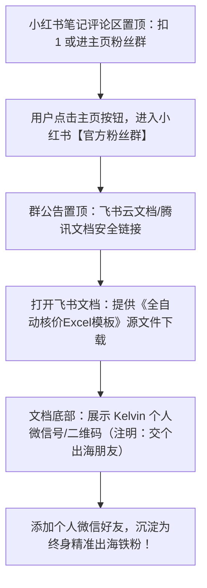

# 🎯 KelvinFlow 出海工具矩阵·小红书 0 到 1 战略定位与冷启动总案 (V3 终极实战版)

> **战略基调重塑**：**社群为王，以精打痛（Community-First, Product-Second）**  
> 不搞几十个浅尝辄止的边缘工具，而是立足大湾区，先把精准出海老友社群聚起来，通过真实痛点调研与社群投票，打造极少、极精、直击要害的出海自动化精品工具！

---

## 一、 账号包装与命名体系（专为 Kelvin 定制）

### 1. 粤语口语化爆款昵称精选（全部围绕真实程序员人设）

结合您喜欢的 `代码佬Kelvin` 与 `Kelvin专写Bug`，为您推荐 8 个极具辨识度的大湾区程序员昵称：

| 方案 | 推荐昵称 | 语感与风格解析 | 推荐指数 |
| :--- | :--- | :--- | :--- |
| **首选 1** | **`代码佬Kelvin`** | **最自然、最接地气！** 广东人叫“代码佬”就像叫“修车佬”、“卖鱼佬”一样亲切随和，毫无距离感。 | ⭐⭐⭐⭐⭐ |
| **首选 2** | **`Kelvin专写Bug`** | **反差幽默感拉满！** 自嘲写 Bug，实际做工具，最能消除用户的防备心，评论区互动率极高。 | ⭐⭐⭐⭐⭐ |
| **首选 3** | **`Kelvin改紧Bug`** | **地道粤语进行时态！** “改紧Bug”是广东程序员最真实的日常状态，形象跃然纸上。 | ⭐⭐⭐⭐☆ |
| **备选 4** | **`Kelvin唔写Bug`** | 粤语谐音正能量，幽默好玩。 | ⭐⭐⭐⭐☆ |
| **备选 5** | **`出海代码佬Kelvin`** | 兼顾个人昵称与“出海”长尾搜索词，利于算法精准打标。 | ⭐⭐⭐⭐☆ |
| **备选 6** | **`写Code嘅Kelvin`** | 纯正大湾区 IT 人日常自称，亲切自然。 | ⭐⭐⭐⭐ |
| **备选 7** | **`Kelvin折腾出海`** | 突出“折腾”、“搞事情”的独立开发者极客精神。 | ⭐⭐⭐⭐ |
| **备选 8** | **`代码仔Kelvin`** | 年轻有冲劲、踏实做工具的青年开发者人设。 | ⭐⭐⭐⭐ |

---

### 2. 头像 AI 生成专属 Prompt（直接复制到 Banana2 / Midjourney / FLUX）

为了帮您生成一张兼具**极客技术感、亲和力、以及独立开发者质感**的专属头像，提供以下高转化提示词：

#### 🎨 Banana2 / Midjourney / FLUX 英文提示词 (Prompt)：
```text
A modern minimalist avatar of a young Asian male software developer, stylish black-rimmed glasses, wearing a dark comfortable hoodie, sitting in front of a sleek desk setup with a glowing laptop, subtle code and terminal interface reflected on screen, gentle warm ambient lighting mixed with cyber teal backlights, friendly confident smile, pixar 3D stylized illustration mixed with modern tech aesthetics, clean background, 8k resolution, profile avatar composition, high detail, masterpiece --ar 1:1 --v 6.0
```

#### 🎨 中文参数与画面构图描述（若使用国内中文生图工具）：
```text
现代极简扁平3D科技风头像，一位年轻的中国大湾区软件工程师，戴着黑色细框眼镜，身穿深灰色连帽衫，坐在整洁的电脑桌前，笔记本屏幕散发着微弱的代码与终端蓝青色光芒，面带亲切自信的微笑，现代科技感与生活气息兼具，背景柔和微暗虚化，皮克斯3D角色渲染风格，高清晰度，适合作为个人社交平台头像。
```

> **贴心建议**：生成好卡通人物后，可以用手机画图软件或在线工具，在头像的右下角贴一个微小的 KelvinFlow 极简 Logo 作为徽章，效果无敌！

---

## 二、 核心转化工具重塑：废除鸡肋自查表，重构万能 Excel 模板

### 1. 为什么原先的《报价自查表》吸引力不够？
* **痛点本质**：没有人会主动想去做一张“自查清单/考卷”。外贸业务员和 SOHO 每天累死累活，他们最想要的不是“发现自己哪里错了”，而是**“直接拿来就能套用、立刻省下两小时的现成武器”**！

### 2. 具有 10 倍吸引力的终极 Lead Magnet（重塑方案）：
👉 **《2026 外贸全自动核价与装箱计算 Excel 模板（含自动汇率与锁格防泄露版）》**

这份资料为什么在外贸圈能杀疯？
1. **真实可用的生产力**：内置全套做好的阶梯底价联动公式、FOB/CIF 杂费分摊公式；
2. **解决最大痛点（锁格防泄密）**：特意做了 Excel 保护锁格，教他们怎么一键隐藏工厂真实底价公式，只对外输出纯净报价；
3. **柜型速算库**：包含 20GP / 40HQ 常见尺寸箱型极限装载量速查速算表；
4. **与 KelvinFlow 完美呼应**：在 Excel 第一行写上一行小字：“*如果觉得用 Excel 还是繁琐，体验下一代 3 秒全自动云端出单工具 KelvinFlow（见文末说明）*”。

---

## 三、 个人微信私域承接与合规防封全流程（0 企微门槛）

您目前只有个人微信，**这恰恰是最大的优势**！在独立开发圈和出海圈，个人微信的信任感和人情味远超冷冰冰的企业微信。



### 1. 小红书群公告置顶文案（100% 合规防封）：
> “出海老友们好！我是写代码的 Kelvin。承诺大家的《2026外贸全自动核价与装柜计算Excel模板》源文件已整理好，点击下方文档即可直接下载：  
> 🔗 [飞书云文档链接]  
> 里面还有云端工具 KelvinFlow 的免审测试入口。平时有任何外贸算价或工具 bug，随时在群里@我，我连夜提代码更新！”

### 2. 飞书文档内部的个人微信引流文案：
> 在文档末尾附上您的个人微信二维码与微信号：  
> *“我是 Kelvin，坐标大湾区的独立开发者。平时喜欢用代码给做外贸出海的朋友做点轻量提效工具。欢迎加个微信交个出海朋友，日常如果遇到任何繁琐、机械、折磨人的重复工作，随时跟我吐槽，人多我直接排期写成工具免费放出来！”*

---

## 四、 “社群为王·以精打痛”核心发展战略

**完全认同您的重大战略转向：工具不在多，而在精！**

1. **第一阶段：以 KelvinFlow 为支点，聚拢前 500 个精准出海种子用户**  
   - 不急于做 Tool 2、Tool 3；
   - 专心用 KelvinFlow 把外贸报价、装箱核算这个痛点打透，建立核心粉丝群（“出海代码佬交流圈”）；
2. **第二阶段：在群内开启真实需求调研与投票（Build in Public）**  
   - 当粉丝群积累到 200~500 人时，在群里发起投票：  
     *“老友们，最近在规划下一阶段开发计划，大家平时最讨厌干哪件事？*  
     *A. 批量抓取买家 WhatsApp 与邮箱*  
     *B. 跨境多语言开发信自动撰写*  
     *C. 国际海运费实时比价与追踪*  
     *D. 独立站产品批量改图与翻译”*
3. **第三阶段：精准制造爆品，上线即收费**  
   - 票数最高的需求，代表市场最强烈的刚需！
   - 您带着群友的期望去写代码，工具上线的第一天，群里的这几百人就是您最坚固的忠实付费用户与口碑传播者！
